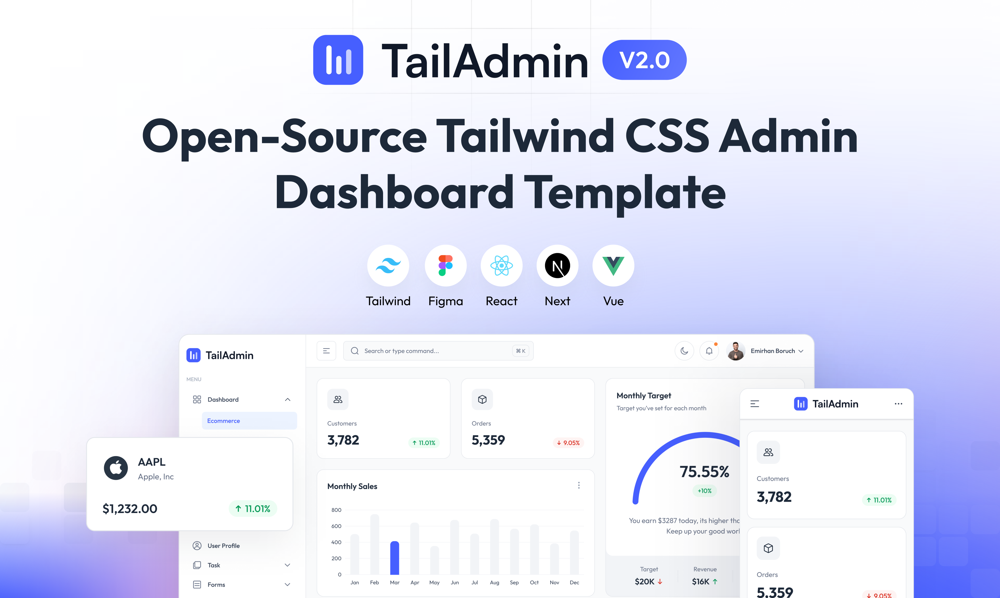

# TailAdmin React - Free React Tailwind Admin Dashboard Template

For this project's Cloudflare Worker routing, local checks, and release steps, see
[CLOUDFLARE.md](./CLOUDFLARE.md).

TailAdmin is a free and open-source admin dashboard template built on **React and Tailwind CSS**, providing developers
with everything they need to create a comprehensive, data-driven back-end,
dashboard, or admin panel solution for upcoming web projects.

With TailAdmin, you get access to all the necessary dashboard UI components, elements, and pages required to build a
feature-rich and complete dashboard or admin panel. Whether you're building dashboard or admin panel for a complex web
application or a simple website, TailAdmin is the perfect solution to help you get up and running quickly.



## Overview

TailAdmin provides essential UI components and layouts for building feature-rich, data-driven admin dashboards and
control panels. It's built on:

- React 19
- TypeScript
- Tailwind CSS v4

### Quick Links

- [✨ Visit Website](https://tailadmin.com)
- [📄 Documentation](https://tailadmin.com/docs)
- [⬇️ Download](https://tailadmin.com/download)
- [🖌️ Figma Design File (Community Edition)](https://www.figma.com/community/file/1214477970819985778)
- [⚡ Get PRO Version](https://tailadmin.com/pricing)

### Demos

- [Free Version](https://free-react-demo.tailadmin.com/)
- [Pro Version](https://react-demo.tailadmin.com)

### Other Versions

- [HTML Version](https://github.com/TailAdmin/tailadmin-free-tailwind-dashboard-template)
- [Next.js Version](https://github.com/TailAdmin/free-nextjs-admin-dashboard)
- [Vue.js Version](https://github.com/TailAdmin/vue-tailwind-admin-dashboard)
- [Angular Version](https://github.com/TailAdmin/free-angular-tailwind-dashboard)
- [Laravel Version](https://github.com/TailAdmin/tailadmin-laravel)

## Installation

### Prerequisites

To get started with TailAdmin, ensure you have the following prerequisites installed and set up:

- Node.js 18.x or later (recommended to use Node.js 20.x or later)

### Cloning the Repository

Clone the repository using the following command:

```bash
git clone https://github.com/TailAdmin/free-react-tailwind-admin-dashboard.git
```

> Windows Users: place the repository near the root of your drive if you face issues while cloning.

1. Install dependencies:

   ```bash
   npm install
   # or
   yarn install
   ```

2. Start the development server:
   ```bash
   npm run dev
   # or
   yarn dev
   ```

## Components

TailAdmin is a pre-designed starting point for building a web-based dashboard using React.js and Tailwind CSS. The
template includes:

- Sophisticated and accessible sidebar
- Data visualization components
- Prebuilt profile management and 404 page
- Tables and Charts(Line and Bar)
- Authentication forms and input elements
- Alerts, Dropdowns, Modals, Buttons and more
- FAQ & Accordion, Testimonials, and Carousels
- Can't forget Dark Mode 🕶️

All components are built with React and styled using Tailwind CSS for easy customization.

## Feature Comparison

### Free Version

- 1 Unique Dashboard
- 35+ dashboard components
- 50+ UI elements
- Basic Figma design files
- Community support

### Pro Version

- 7 Unique Dashboards: Analytics, Ecommerce, Marketing, CRM, SaaS, Stocks, Logistics (more coming soon)
- 500+ dashboard components and UI elements
- Complete Figma design file
- Email support

To learn more about pro version features and pricing, visit our [pricing page](https://tailadmin.com/pricing).

## Changelog

### Version 2.3.0 - [April 28, 2026]
- Added **AI Dashboard** with token usage and revenue tracking.
- Added **Sales Dashboard** with retention and multi-channel analytics.
- Added **Finance Dashboard** with cashflow and balance management.
- Introduced **6 New Layout variations** for improved UI flexibility.
- Integrated **Advanced Data Visualization** with 7+ new chart types.

### Version 2.1.0 - [Dec 30, 2025]

- Resolved Date Picker positioning and input issues in Charts.

### Version 2.0.2 - [March 25, 2025]

- Upgraded to React 19
- Included overrides for packages to prevent peer dependency errors.
- Migrated from react-flatpickr to flatpickr package for React 19 support

### Version 2.0.1 - [February 27, 2025]

#### Update Overview

- Upgraded to Tailwind CSS v4 for better performance and efficiency.
- Updated class usage to match the latest syntax and features.
- Replaced deprecated class and optimized styles.

#### Next Steps

- Run npm install or yarn install to update dependencies.
- Check for any style changes or compatibility issues.
- Refer to the Tailwind CSS v4 [Migration Guide](https://tailwindcss.com/docs/upgrade-guide) on this release. if needed.
- This update keeps the project up to date with the latest Tailwind improvements. 🚀

### Version 2.0.0 - [February 2025]

A major update with comprehensive redesign and modern React patterns implementation.

#### Major Improvements

- Complete UI redesign with modern React patterns
- New features: collapsible sidebar, chat, and calendar
- Improved performance and accessibility
- Updated data visualization using ApexCharts

#### Key Features

- Redesigned dashboards (Ecommerce, Analytics, Marketing, CRM)
- Enhanced navigation with React Router integration
- Advanced tables with sorting and filtering
- Calendar with drag-and-drop support
- New UI components and improved existing ones

#### Breaking Changes

- Updated sidebar component API
- Migrated charts to ApexCharts
- Revised authentication system

[Read more](https://tailadmin.com/docs/update-logs/react) on this release.

### Version 1.3.7 - [June 20, 2024]

#### Enhancements

1. Remove Repetition of DefaultLayout in every Pages
2. Add ClickOutside Component for reduce repeated functionality in Header Message, Notification and User Dropdowns.

### Version 1.3.6 - [Jan 31, 2024]

#### Enhancements

1. Integrate flatpickr in [Date Picker/Form Elements]
2. Change color after select an option [Select Element/Form Elements].
3. Make it functional [Multiselect Dropdown/Form Elements].
4. Make best value editable [Pricing Table One/Pricing Table].
5. Rearrange Folder structure.

### Version 1.2.0 - [Apr 28, 2023]

- Add Typescript in TailAdmin React.

### Version 1.0.0 - Initial Release - [Mar 13, 2023]

- Initial release of TailAdmin React.

## License

TailAdmin React.js Free Version is released under the MIT License.

## Support

If you find this project helpful, please consider giving it a star on GitHub. Your support helps us continue developing
and maintaining this template.

# Power Rankings snapshot pilot

Power Rankings can read a saved result for Full Season, Months, and Scoring Periods. The same result supports Player Rankings, Team Rankings, and Rookie Watch. The browser uses the current loaders if the pilot is disabled, the selected range has no snapshot, or Supabase cannot return it.

The snapshot migration was applied to the connected `greatlakesdynasty.ca`
Supabase project (`ptexqhshfyjfnmlwyzzv`) on November 24, 2026. Server writes,
signed-in reads, anonymous denial, and client write denial were verified with a
rolled-back database probe; an anonymous REST request also returned HTTP 401.
The Worker URL is configured in `wrangler.jsonc`, and the server secret and
snapshot schedule were deployed on November 24, 2026 (initial Worker version
`dfb1007a-a7ee-43ae-85f8-04cb9f4070f7`). A real October 2026-season snapshot
(stats through October 31, 2025) was then saved and verified: 194 rostered players,
10 teams, consistent team totals, and successful signed-in role access. Production
builds enable snapshot reads through `.env.production`; missing ranges retain the
existing loaders while the scheduled backfill progresses. To disable snapshot
reads, set `VITE_RANKING_SNAPSHOTS=false` in the build environment and rebuild.
Worker variables do not set Vite build variables. The activated production Worker
version is `4c70b82e-fbec-4d86-8c0a-5af4d8fd93bb`.

To enable the pilot in another environment:

1. Apply `20261124202832_create_power_ranking_snapshots.sql`, then
   `20261124204724_add_power_ranking_snapshot_sources.sql`, to the test Supabase
   project. The table uses row-level security and only the server can write.
2. Set the snapshot Worker runtime variables `RANKING_SNAPSHOTS_SUPABASE_URL` and `RANKING_SNAPSHOTS_SERVICE_ROLE_KEY`. Store the key as a Cloudflare secret and keep it out of the Vite build and Git. Without both settings the scheduled snapshot job is disabled.
3. Deploy the Worker to the test environment. At minutes 5 and 35 of each UTC hour, it can build one due range. Current ranges use completed games through the previous NHL day. The job fills missing ranges gradually, building missing comparison ranges first. Each run fetches only one range of NHL reports and saves the public NHL inputs in a separate `source_stats` column for later movement comparisons. The browser selects only the ranking results. Completed ranges are revisited after seven days so NHL corrections can be picked up. A failed refresh leaves the stored result in place.
4. Check for a saved row, then set `VITE_RANKING_SNAPSHOTS=true` in the frontend build environment. Compare the three tabs against the existing calculations using a signed-in account and check that an unauthenticated API request cannot read the snapshots. Set the flag to `false` and rebuild to revert the page to the existing loaders.

Run `node --test worker/rankingSnapshots.test.mjs` for offline refresh checks,
`node scripts/test-ranking-snapshot-runtime.mjs` for the database fetch/write
regression in workerd, and `node scripts/test-rankings-runtime.mjs` for the local
Chrome rendering checks. Background NHL requests are spaced 15 seconds apart,
and database pagination uses up to 1,000 rows per page to keep a refresh within
the Worker subrequest budget. With Docker running, `bash scripts/test-ranking-snapshot-migration.sh` applies the migration and verifies permissions in a disposable PostgreSQL database.


## Saved season data for Standings and stat pages

Standings, Skater Stats, and Goalie Stats share the complete NHL season inputs
already saved by the Power Rankings Worker. No additional crawler, cron trigger,
or database table is needed. The current-season snapshot through November 23,
2026 was populated by the scheduled production job on November 24 and verified
against the shared reader: 789 skaters, 79 goalies, and unchanged fantasy totals.

`VITE_SEASON_SNAPSHOTS=true` enables this reader in production builds. Current
season reads require a snapshot covering exactly the previous NHL day, then add
today's shared live box scores with the existing merge and scoring functions.
Historical reads require a full-season snapshot through April 30. Missing,
malformed, or mismatched coverage uses the existing complete-report loaders.
Standings Today and Yesterday retain their existing daily statistics requests.
Fantasy ownership, contracts, branding, and filters continue using their current
league data. Only public NHL arrays enter the existing browser NHL cache.

The three pages share in-flight lookups and a five-minute snapshot lookup cache.
Live totals keep the existing refresh behavior and preserve the last good result
if a refresh fails. Crossing the 6 a.m. Toronto hockey-day boundary requires a new
baseline check so the previous day's live points cannot be carried forward or
counted twice. A first-load live outage displays completed-game totals with a
saved-data notice. Set `VITE_SEASON_SNAPSHOTS=false` in the build environment and
rebuild to roll back these three consumers. The deployed production version is
`ce43c29f-9007-4999-9fc9-4a3bdaf999b9`.

Validation commands:

```bash
node --test src/lib/leagueSeasonStats.test.mjs
node scripts/test-season-pages-runtime.mjs
node scripts/test-standings-runtime.mjs
npm run build
```

The browser checks exercise all three actual pages with saved data and missing
snapshots, compare season totals, switch current/historical seasons, and exercise
stat sorting, search, and ownership filters. Unit checks also cover live merging,
rate-limit outages, invalid source data, shared requests, and the hockey-day
boundary. The optional `NHL_SEASON_SNAPSHOT_FIXTURE` environment variable points to
a local JSON export of public season inputs for checking real stored data; no
credentials or league roster records belong in that fixture.


## Shared saved season data on team pages

Team roster, lineup, and multi-year views now reuse the same saved NHL season
reader as Standings and the stat pages. Today's live scoring still merges with
the through-yesterday baseline. Missing saved seasons use the existing loaders.
Roster, salary, contract, leadership, and multi-year data keep their existing
league queries; future-year contract columns do not trigger extra NHL reports.

Team/season navigation discards late roster and multi-year responses, and only
the newest season or daily score request can update its view. Browser checks in
`node scripts/test-season-pages-runtime.mjs` cover team roster, lineup, multi-year,
historical seasons, saved-data fallback, and rapid season switching with delayed
roster responses.

Team-page production version: `a080091d-4751-479b-8c36-da4f772a4883`.


## Shared Farm System Rankings

`VITE_FARM_SNAPSHOTS=true` enables shared Farm System Rankings. Apply
`20261124213835_create_farm_ranking_snapshots.sql` before enabling this flag.
Signed-in members can read the saved display and public draft inputs; only the
Worker can write. Salary, contract, manager, account, and roster records are not
stored in the shared result or public browser ranking cache.

The Worker refreshes the shared result at minutes 10, 25, 40, and 55 using the
existing snapshot URL and server-secret bindings. It reuses the complete saved
NHL season baseline and all ownership-history pages. Completed draft history is
cached in the database for seven days. The initial seven-year backfill used
complete responses from the production NHL proxy; the first normal remote
refresh then completed with zero NHL requests. The background production job
has subsequently refreshed the ten-team snapshot successfully.

The browser checks fresh league inputs and live season production on the
existing five-minute ranking refresh cycle. A canonical SHA-256 fingerprint
allows an unchanged saved result to be reused. Changes to production, ownership,
branding, or known age eligibility recalculate with the shared draft inputs,
using the same 85/10/5 ranking formula. Draft JSON property order does not affect
the fingerprint. Missing/invalid shared data uses the original draft loader.
Failures preserve the last complete display. Set `VITE_FARM_SNAPSHOTS=false` and
rebuild to roll back this reader. Team-specific Front Office aging alerts also
reuse the relevant saved draft classes and the shared season reader.

Checks: `node --test src/lib/*.test.mjs worker/*.test.mjs`,
`node scripts/test-farm-rankings-runtime.mjs`, and
`node scripts/test-farm-rankings-runtime.mjs --shared`. These cover ownership
pagination, signings/transfers, live production, eligibility changes, cached
requests, failure preservation, privacy field filtering, first render and saved
reload, plus the shared producer's valid/invalid draft responses.

Shared farm-reader production version: `6af3d55e-178d-4a0e-ab50-7c72907fcdb1`.


## Shared data in My Front Office and Roster Lab

My Front Office reuses current and historical saved NHL seasons, with the same
live-day merge as Standings. Position-specific historical fallback requests only
the missing skater or goalie group, and a failed group does not discard the other.
Aging alerts use saved draft inputs for the team's relevant older draft classes;
current ownership is always read from the league.

Roster Lab loads its complete contract history, five years of buyouts and
retentions, teams, and assignment independently of optional NHL production and
prospect history. Contracts are paginated by ID so the Data API's row limit
cannot silently truncate projections. Failed financial reads show a retry screen
instead of treating missing penalties as zero. NHL production and prospect rights
show loading/error notices independently; unknown production is not presented as
zero before statistics load. Saved farm drafts cover seven of the ten rights
classes; the remaining years use the existing cached NHL loader. Ownership and
transaction overrides remain fresh.

NHL refreshes and arriving prospect data only update their own displays. They do
not reload the contract scenario or erase mock moves. User changes reset the
scenario and ignore previous-user responses. Salary/cap formulas, move rules,
undo/reset, and five-year projections are unchanged. Simulated moves and full
contract data stay in component memory; this adds no simulator writes or shared
financial snapshot.

Checks: `node --test src/lib/*.test.mjs worker/*.test.mjs`,
`node scripts/test-frontoffice-runtime.mjs`, and
`node scripts/test-rosterlab-runtime.mjs`. Browser fixtures exercise slow/failed
optional inputs, financial failure/retry, live refresh preserving moves, status
changes, retained trades, multi-year buyouts, call-ups, signings, undo/reset, and
account changes. Shared-reader tests cover deduplicated reads and partial failure.

Front Office / Roster Lab production version:
`2d4ed7b9-543a-44d9-abc5-15b5717f2c21`. Both production routes and the six affected
page/shared JavaScript files were verified against the tested build.

## Shared League Record Book inputs

The five Record Book tabs share a paginated, five-minute in-memory load of
contracts, signing history, teams and branding. These financial/ownership inputs
are read fresh from Supabase after expiry and are never saved in the public NHL
cache. The Contracts tab performs no NHL requests. Completed tab results appear
immediately on return while refreshes run; current records refresh after one
minute and completed seasons after five minutes. Cache identity includes the
hockey day, season, franchise, date cutoff, and section.

`VITE_RECORD_BOOK_SNAPSHOTS=true` enables `record_book_nhl_ranges`, containing
only public NHL skater/goalie scoring inputs for closed trade/call-up spans.
Apply `20261125042423_create_record_book_nhl_ranges.sql` and
`20261125043816_create_record_book_range_players.sql` first. Authenticated
members can read; the existing Worker service secret is required for writes.
Ownership and contract calculations still use fresh league data. Full-season
leaders and seasonal positional records reuse the shared season reader; the
completed historical season can also use the Record Book full-season span.

Franchise records preserve the existing trade-date and call-up attribution.
Completed spans come from the shared table, and today's box scores merge once
into the through-yesterday tail. The previous-day movement comparison has its
own completed tail. Invalid/missing shared spans use the original NHL reports;
failed refreshes preserve the last complete result with a notice. No partial
leader totals are published as complete records.

A security-invoker view provides only played-player IDs, positions and game
counts for planning, avoiding repeated full-season stat downloads by the job.
The Worker checks one due span at minutes 1, 11, 21, 31, 41 and 51, building full
seasons before ownership spans and rechecking completed inputs after seven days.
New daily tails and new transaction boundaries take priority over old spans.
Current full seasons can reuse the existing saved season baseline. A new daily
ownership tail can subtract contiguous completed intervals from that baseline;
raw shots-against and seconds-played fields preserve the NHL rate-stat precision.
The initial real-data check matched every checked field for 658 skaters and 65
goalies against the official dated tail report. Missing coverage or inconsistent
subtractions require the original NHL report. A trade starting today uses the
shared live box scores directly.
Requests are paced and bounded; failed, partial, or stale provider reports never
overwrite saved inputs. The first backfill uses complete, paginated official NHL
reports from the local connection because the Cloudflare source was rate limited.
Set the frontend flag false and rebuild to roll back the new range reader.

Checks: `node --test src/lib/*.test.mjs worker/*.test.mjs` and
`node scripts/test-recordbook-runtime.mjs`. The browser check exercises all five
tabs, historical filtering, rapid tab changes, exact trade ownership credit,
missing snapshots, and Contracts during an NHL outage. Shared fixtures render
all tabs with zero league-wide NHL report requests.

Initial verification found all 30 currently required spans populated (32 saved
rows including superseded spans); a normal remote maintenance check required
zero NHL reports. The final 222 unit checks and all-five-tab browser scenarios
passed, as did the production build and Worker dry run.

Record Book production version: `e0984e9f-16cb-43d3-af93-0b47ce96b4c7`.


## Record Book sections and Career Earnings

Record Book navigation now contains FPT Leaders, FPT Franchise Leaders,
Franchise Records, League Records, Best/Worst, Contracts, and Career Earnings.
Franchise Records always selects one franchise; League Records shows the league
board without that filter, including when opened from a team Record Book.
Section links use `/record-book?view=...`; Career Earnings is a dedicated
protected `/career-earnings` page with a sidebar link and shared navigation.

Career Earnings reuses the same in-memory league inputs and requests no NHL
statistics. The default ranks recorded annual contract salaries through the
current season, including its full annual salary. A separate total-contract-value column includes future commitments beside
earnings so far, with sorting by either amount and split earned/total year
counts. Search preserves global ranking numbers;
expandable season lists show each salary and the number of contract years.
One player-season counts once across trades and duplicate player records.
Retention cap charges are not additional earnings. Signing history fills cleared
salary rows through the buyout season; later terminated years are excluded.
These are recorded annual contract values, not prorated cash payments.

Checks: `node --test src/lib/careerEarnings.test.mjs`,
`node scripts/test-recordbook-runtime.mjs`, and
`node scripts/test-career-earnings-runtime.mjs`, plus the full suite and build.

Reorganized Record Book / Career Earnings production version:
`6605bc3e-d83d-40be-be8f-95a4d785999e`. Validation: 229 unit tests, renamed/split
Record Book browser checks, Career Earnings browser checks, build and dry run.

Side-by-side earned/total earnings version:
`75a09ea4-ffaf-4269-a1ac-8de61c941d73`. The page displays both amounts and
so-far/total year counts at once, ranked by earned so far by default. Ranking
by total contract value is available without another data request. Salary unit
checks, browser split/sorting/retry checks, and production build passed.


## Separate statistics and money books

The sidebar now separates Leaders & Record Books (`/record-book`) from Contracts &
Earnings (`/contracts`). Leaders & Record Books contains only FPT Leaders, FPT
Franchise Leaders, Franchise Records, League Records, and Best/Worst. Contracts &
Earnings contains Contracts and Career Earnings (`/career-earnings`). The money
sidebar item remains active on either money page. Existing
`/record-book?view=contracts` links still open the contract book. The statistics
capture controls remain in the statistics book. Both books retain the existing
shared input caches, and the side-by-side earnings calculations are unchanged.

Separate-books production version: `44e0bf16-8627-4026-8e6e-e1d0578251e5`.
Statistics/money navigation separation, financial-outage behavior, earnings
sorting/retry browser checks, and production build passed.

Career Earnings profile links use the existing canonical
`/player-profile?playerId=...` route. The protected legacy
`/player-profile/:playerId` route redirects to that URL while preserving season
parameters. Browser checks cover clicking Makar's ID 8480069 from earnings,
canonical link generation, old-link redirection and authentication protection.

Profile-link fix production version: `013f720c-361b-4173-8478-16d737a9f7e6`.


## Sidebar organization

Navigation is grouped by purpose, with My Front Office and Roster Lab first:
My Team; League; Stats & Records; Trades & Contracts; and Community. Rankings,
player stats, awards, and Leaders & Record Books live together. Trading,
auctions, Contracts & Earnings, and the draft share the money/transactions group.
Around the Horn and Transactions / News sit first in League for frequent access. League Chat lives in Community. Admin
remains permission-controlled, and signed-out account navigation stays separate.
All existing destinations and the earnings-page money-menu highlight remain.

Sidebar organization / Leaders & Record Books rename version:
`fc8be7d6-e5d7-4fd5-aac6-2dbe19cf04c5`. Production build and existing route/auth
browser smoke checks passed.

Frequent-news navigation version: `03226ce3-70db-4e0e-8d2f-c4de7cc63f48`.
Around the Horn and Transactions / News now lead the League section; League
Chat remains under Community. Production build and deployed bundle verification
passed.


## Cap totals and CBA scoring consistency

Public team and league cap pages read team/season adjustment totals from
`team_cap_adjustment_totals`. The aggregate exposes only buyout totals,
retention net, and slot counts; player-level financial rows remain protected by
their existing RLS policies. Database triggers keep the aggregate synchronized
after adjustment inserts, updates, and deletes. The team page uses one shared
cap calculator for both its current cards and five-year table, so every season
includes recorded buyout and retention adjustments. The league cap overview
uses that same calculation.

The CBA goalie formula now matches the unchanged scoring engine: goalie penalty
minutes have a positive `0.2` weight, and goalie goals and assists retain their
existing `3` and `2` weights.

Migrations: `20261126043651_publish_team_cap_adjustment_totals.sql` and
`20261126044012_lock_down_cap_adjustment_trigger_functions.sql`.
Production version: `d9f0178e-e9fc-4771-8a87-c431837a2e64`.
Validation: production build, 231 tests, anonymous REST/RLS read, signed-out
Hawksville cap rendering, security advisors, and deployed bundle verification.
